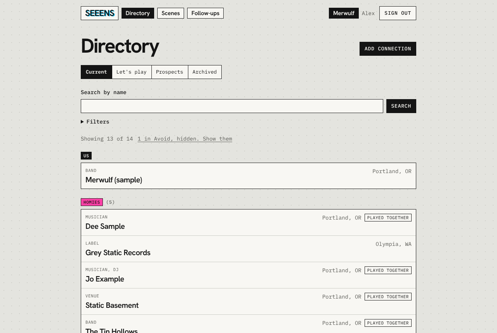
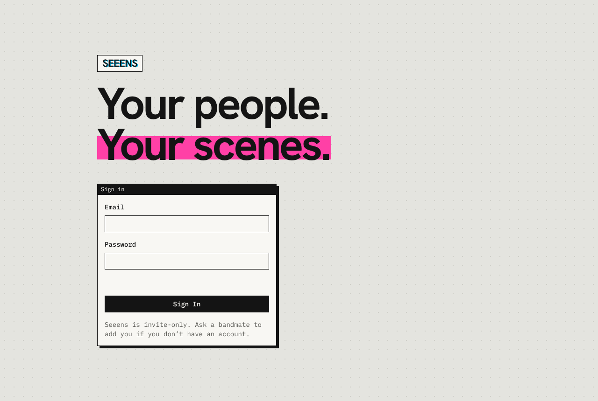
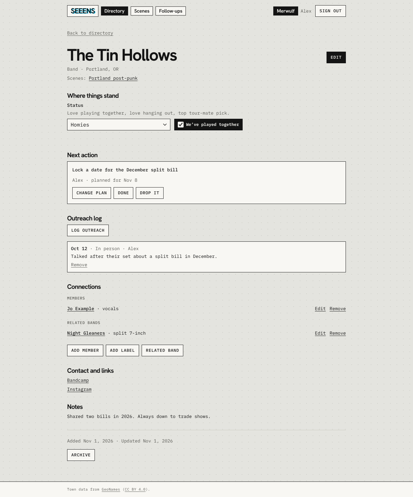
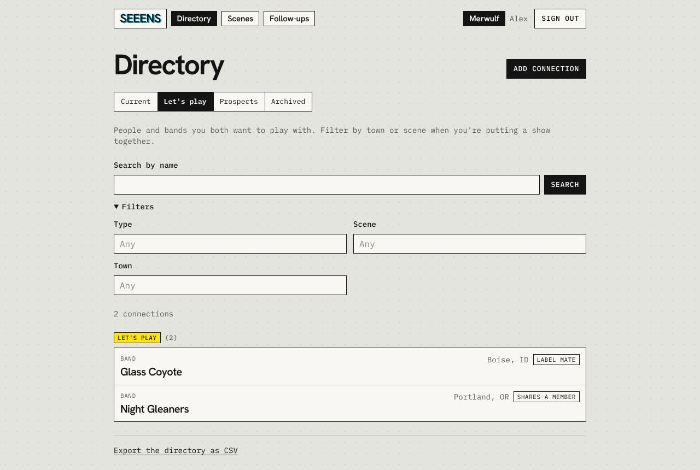
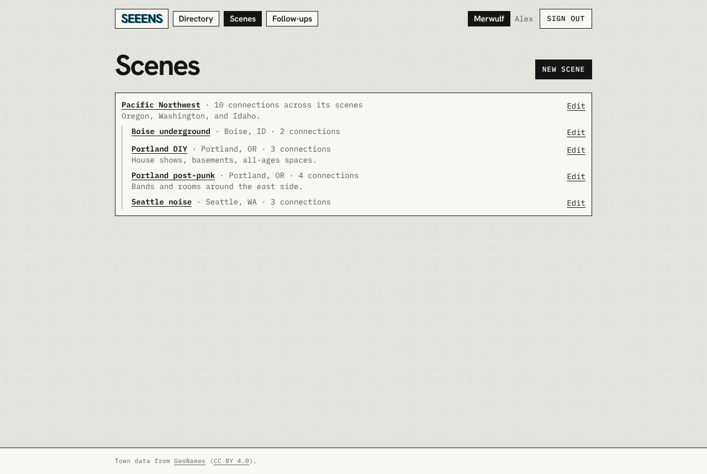
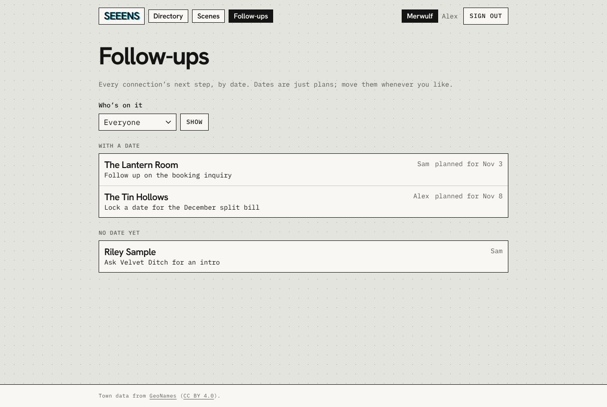
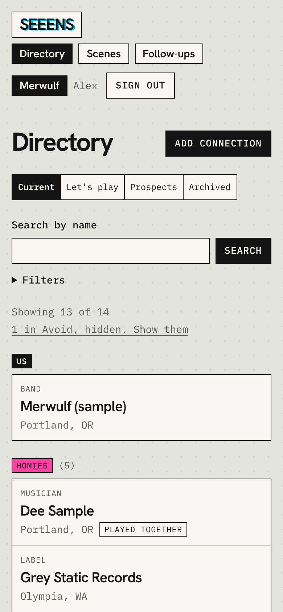

# Seeens

**Your people. Your scenes.**

Seeens helps bands keep track of their music networks and decide whom to reach out to next. Each band gets a private workspace shared by its members, organized around local scenes and real relationships.

Seeens is in closed alpha at [www.seeens.com](https://www.seeens.com). Merwulf is the first band using it.

Formerly Artist Pathway / BandPath / Seeen. The project restarted on October 27, 2026 with a smaller, personal MVP.



## Screenshots

All data shown is fictional sample data from `supabase/seed.sql`.

| | |
| --- | --- |
|  |  |
| **Sign in.** Invite-only. | **A connection.** Where things stand, the next step, what's happened, and who's connected. |
|  |  |
| **Let's play.** The booking backlog, filterable by town or scene. | **Scenes.** Local scenes inside bigger ones, like the Pacific Northwest. |
|  |  |
| **Follow-ups.** Every next step, with dates as plain facts and no overdue alarms. | **On a phone.** The same app, built for the merch table. |

## MVP

- **Connections:** bands, promoters, venues, DJs, playlisters, and other people or organizations in the network.
- **Scenes:** organize connections by locality and scene, with multiple memberships when useful.
- **Status:** one band-wide choice per connection: Homies, Let's play, Prospect, Neutral, or Avoid, plus whether you've played together.
- **Affiliations:** links between connections, such as who plays in which bands, who books which venue, or who works where, shown on each connection's detail page.
- **Prospects:** mark connections you'd like to know as Prospect and work through them in the Prospects view. The booking backlog gets its own Let's play view.
- **Follow-through:** log outreach and keep one next action per connection, with a responsible member and an optional follow-up date. Follow-ups lists every open next action.
- **Shared access:** authorized band members can work with the same private data across devices.
- **Portability:** export the directory to CSV.

Search by name and filter by scene (a bigger scene includes the scenes inside it), town, connection type, and status. Prospects are curated by hand; automated discovery is deferred.

## Architecture

| Layer | Direction |
| --- | --- |
| Frontend | Next.js (App Router) |
| Language | TypeScript |
| Styling | Tailwind CSS |
| Hosting | Vercel |
| Database | Supabase Postgres |
| Authentication | Supabase Auth |
| Authorization | Workspace membership enforced through Row Level Security |
| Fonts | Hanken Grotesk and IBM Plex Mono, self-hosted with Fontsource |
| CI | GitHub Actions: lint, typecheck, and unit tests on every PR and push to main |

Design tokens live in `src/app/globals.css` and mirror the [Seeens Figma file](https://www.figma.com/design/QKSF4MTanGHlnbNvmUKDX0/Seeens?node-id=9-2). See the [design system rules](docs/design-system/rules.md).

Vercel hosts the application. Contact details, notes, and outreach history live in Supabase and are accessible only to authorized members. Browser configuration may contain the Supabase project URL and publishable key; privileged secrets belong outside the frontend and repository.

Configure Supabase authentication redirects for production, approved preview environments, and local development. Keep environment configuration explicit for each deployment environment. Choose server-side functionality only where the MVP needs it.

## Delivery target

Live MVP: **launched November 1, 2026**, ahead of the November 10–17 target.

1. **October 27–November 1 (done):** fields and scene structure, sign-in, membership policies, directory and editor, scenes and filters, statuses, prospects, outreach history, follow-ups, export, mobile layouts, and phase 1 design tokens. Deployed on Vercel.
2. **November 1 (done):** verified collaboration and data access with two members, fixed workflow issues, and launched ([#13](https://github.com/rainbows4dinos/seeens/issues/13)).

Launch means two authorized band members can update the same records across devices, unauthorized users cannot read or change them, and the core add → organize → set status → follow up workflow works on mobile and desktop. CSV export must work. Launch is tracked in [#13](https://github.com/rainbows4dinos/seeens/issues/13).

## Scope boundaries

Automated scraping, AI recommendations, automatic messaging, social integrations, graph visualization, touring routes, public profiles, and multi-band customer support come after the MVP.

Planned after launch, among others:

- [#37](https://github.com/rainbows4dinos/seeens/issues/37) Connection photos
- [#44](https://github.com/rainbows4dinos/seeens/issues/44) Link member accounts to their person in the directory
- [#45](https://github.com/rainbows4dinos/seeens/issues/45) Groups can find, claim, and edit their own listing
- [#21](https://github.com/rainbows4dinos/seeens/issues/21) Scene data capture and discovery (spike)

## Development status

The MVP launched on November 1, 2026. What it does:

- Email/password sign-in, with access limited to workspace members.
- Directory: add, edit, view, and archive connections; Current, Let's play, Prospects, and Archived views; search and filters.
- Scenes, including scenes inside bigger ones, and town search from GeoNames.
- Status and "we've played together," saved as soon as you change them.
- Affiliations between connections (members, labels, related bands, venues).
- Outreach log, next actions, and the Follow-ups page.
- CSV export.
- Error and not-found pages, and phase 1 design tokens from Figma.

Database schema, Row Level Security, and access tests are in `supabase/`. Next up: the phase 2 visual pass ([#12](https://github.com/rainbows4dinos/seeens/issues/12)).

## Local setup

Requires Node 20.9+; `npm test` needs 22.6+ for Node's built-in TypeScript support. CI uses Node 22. Docker is needed only for local Supabase.

```bash
npm install
cp .env.example .env.local   # add the Supabase URL and publishable key
npm run dev                  # http://localhost:3000
```

| Script | Purpose |
| --- | --- |
| `npm run dev` | Dev server |
| `npm run build` | Production build |
| `npm run lint` | ESLint |
| `npm run typecheck` | Route types + TypeScript |
| `npm test` | Unit tests (CSV export round-trip) |
| `npm run db:start` / `db:stop` | Local Supabase via the CLI (Docker) |
| `npm run db:migration <name>` | New versioned migration in `supabase/migrations/` |
| `npm run db:reset` | Rebuild local DB from migrations |
| `npm run db:test` | Run database access tests (`supabase/tests/`) |
| `npm run db:types` | Regenerate `src/lib/supabase/database.types.ts` |

Local Supabase loads fictional seed data from `supabase/seed.sql`. Sign in as `alex@example.com` or `sam@example.com` (members) or `dana@example.com` (not a member), all with password `password123`.

## Database

The schema lives in `supabase/migrations/`. Every private table carries a `workspace_id`, and Row Level Security only lets members of that workspace read or write it. Signing up does not grant access; a member has to be added.

History is kept, not overwritten: connections are archived instead of deleted, status changes are logged, replacing a next action closes the old one (`set_next_action`), and outreach entries can only be changed by their author.

### Pushing to the hosted project

```bash
npx supabase login
npx supabase link --project-ref <project-id>
npx supabase db push --linked
```

### Creating the workspace and adding members

Until the invite flow exists, add members in Supabase. Create their account under Authentication > Users > Add user (email, password, auto-confirm), share the password with them privately, then add the membership in the SQL editor. Public sign-ups should stay turned off in the Supabase auth settings.

```sql
-- once
insert into public.workspaces (name) values ('Merwulf') returning id;

-- per member
insert into public.workspace_members (workspace_id, user_id, role, display_name)
select '<workspace-id>', id, 'member', 'Display Name'
from auth.users where email = 'member@example.com'
returning display_name, role;
```

Without `returning`, the Supabase SQL editor reports 0 rows even when the insert worked.

To remove a member, delete their membership. They can still sign in, but they see "No workspace yet," and the database returns none of the band's data.

```sql
delete from public.workspace_members
where user_id = (select id from auth.users where email = 'member@example.com');
```

Supabase code lives in `src/lib/supabase/`: `client.ts` for Client Components, `server.ts` for server code, and `proxy.ts` for session refresh (wired up in `src/proxy.ts`). Only the project URL and publishable key belong in env vars the app reads. Never add the secret key.

## Place data

Town search uses the GeoNames `cities1000` list (towns with 1,000+ people), loaded into Supabase by migration. Data is © GeoNames, [CC BY 4.0](https://creativecommons.org/licenses/by/4.0/), credited in the app footer. To rebuild the data migration from a newer package: `node scripts/build-places-migration.mjs <timestamp>`.

## Project documentation

- [Product context and data model](docs/context.md)
- [Design system rules](docs/design-system/rules.md)
- [Seeens Figma file](https://www.figma.com/design/QKSF4MTanGHlnbNvmUKDX0/Seeens?node-id=9-2) (source of truth for tokens)
- [Agent instructions](AGENTS.md)
- [Historical BandPath context](docs/archive/bandpath-context.md) (superseded; reference only)
