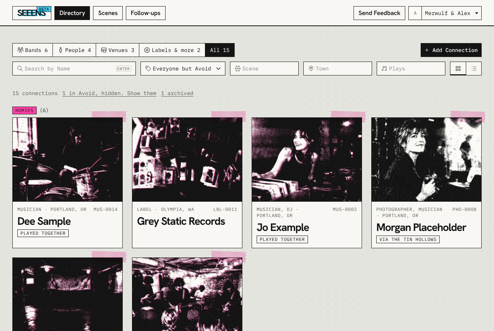
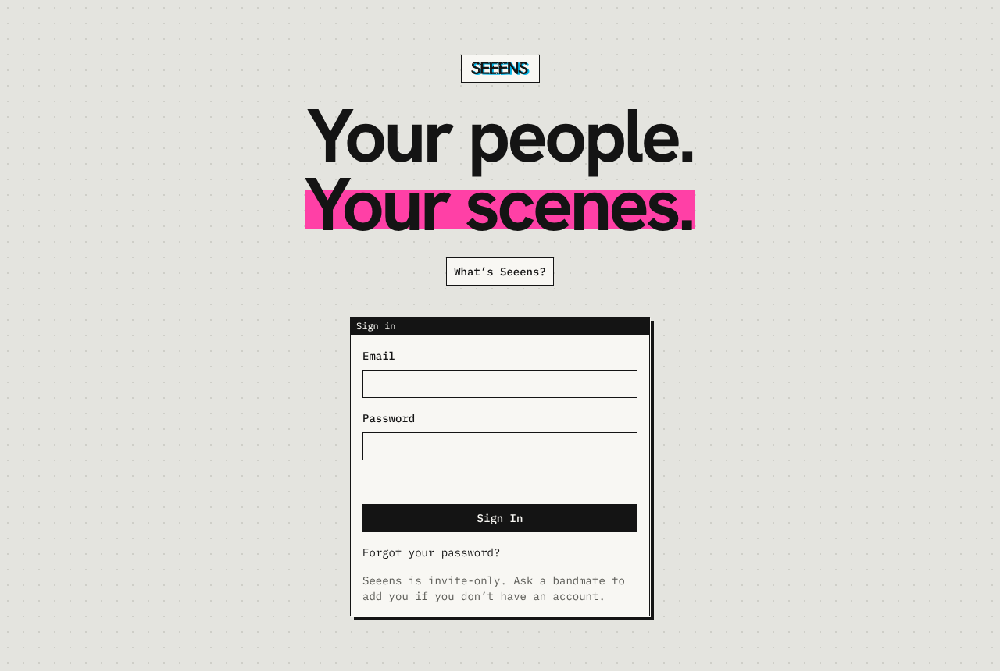
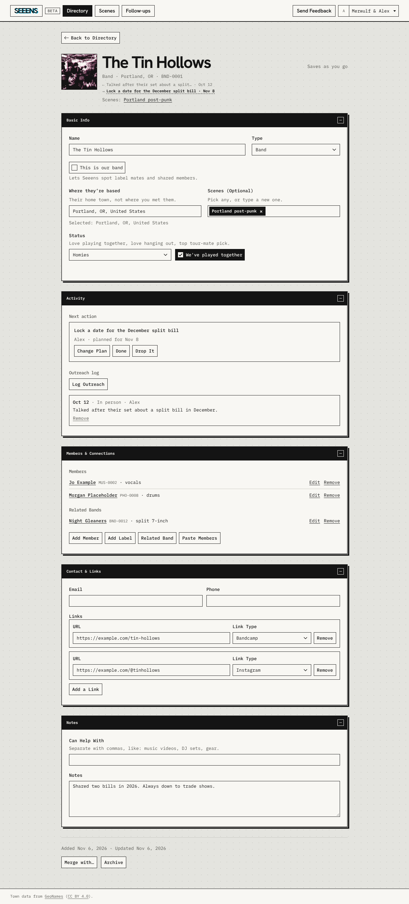
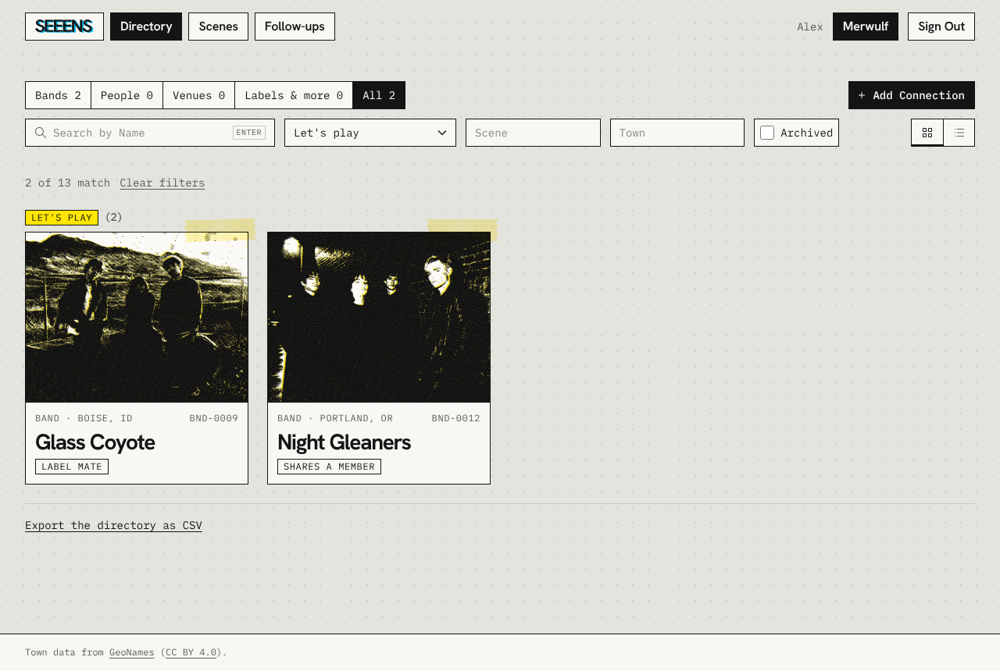
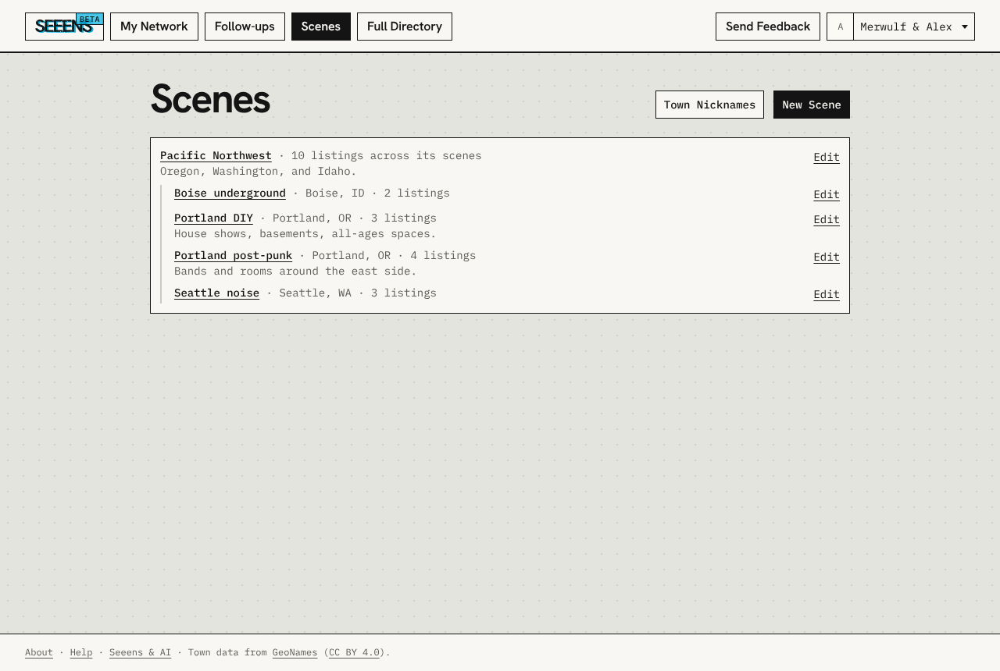
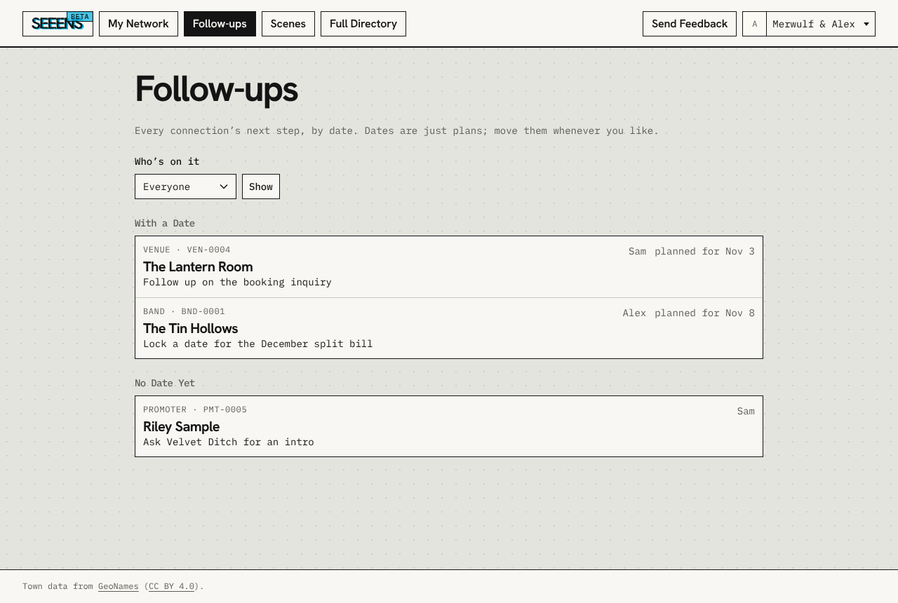
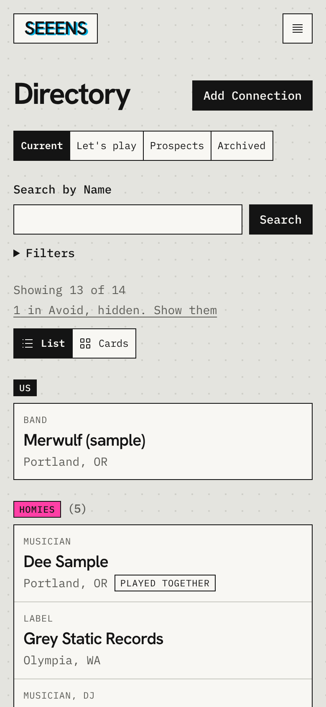
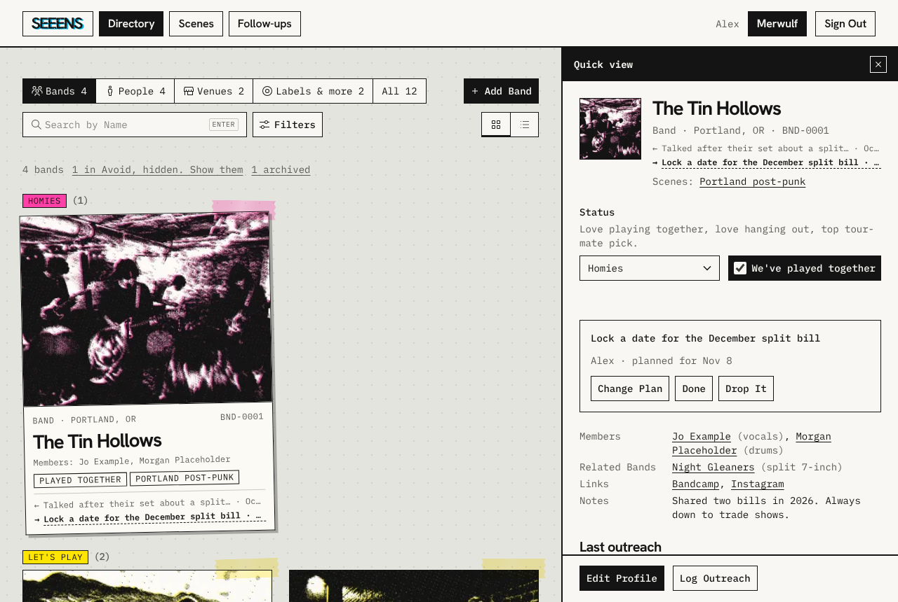
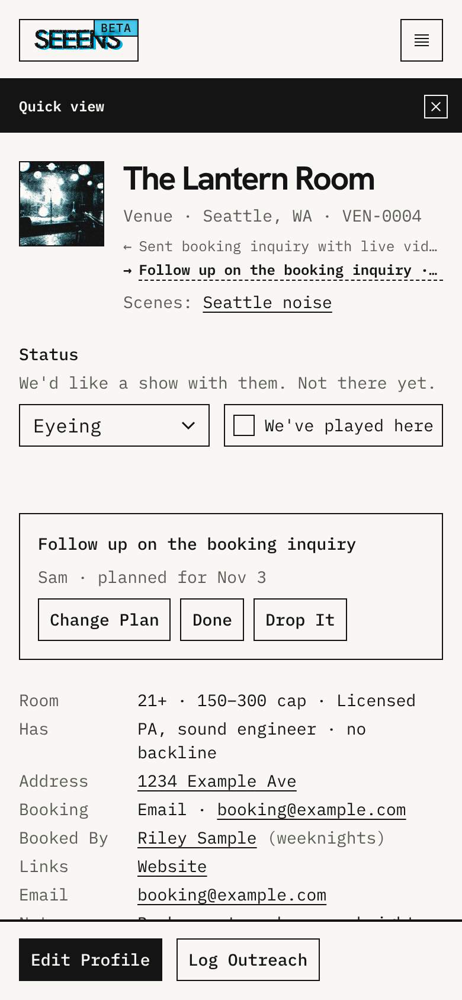

# Seeens

**Your people. Your scenes.**

Seeens helps bands keep track of their music networks and decide whom to reach out to next. Each band gets a private workspace shared by its members, organized around local scenes and real relationships.

Seeens is in closed alpha at [www.seeens.com](https://www.seeens.com). Merwulf is the first band using it.

Formerly Artist Pathway / BandPath / Seeen. The project restarted on October 27, 2026 with a smaller, personal MVP.



## Screenshots

All data shown is fictional sample data from `supabase/seed.sql`. The photos are AI-generated (made-up people and places), in `supabase/seed-photos`, and the screenshot script adds them through the app's photo copier.

To regenerate them, run `npm run db:reset` and `npm run dev`, then `npm run screenshots` (first time: `npx playwright install chromium`).

| | |
| --- | --- |
|  |  |
| **Sign in.** Invite-only. | **A connection.** One page in panels that saves as you go: who they are, the next step and what's happened, who's connected, how to reach them. |
|  |  |
| **Let's play.** The booking backlog: All, filtered to Let's play, and by town or scene if you like. | **Scenes.** Local scenes inside bigger ones, like the Pacific Northwest. |
|  |  |
| **Follow-ups.** Every next step, with dates as plain facts and no overdue alarms. | **On a phone.** The same app, built for the merch table. |
|  |  |
| **Quick view.** Click a row and the connection opens beside the list: change status, handle the next step, log outreach. | **Quick view on a phone.** The same panel as a sheet under the header. |

## MVP

- **Connections:** bands, promoters, venues, DJs, playlisters, and other people or organizations in the network.
- **Scenes:** organize connections by locality and scene, with multiple memberships when useful.
- **Status:** one band-wide choice per connection, in words that fit its type: Homies, Let's play, Eyeing, Known, or Avoid for bands; Favorite and Let's book for venues; Homie and Let's collab for people. Plus whether you've played together (or played here, been booked, been covered, and so on).
- **Affiliations:** links between connections, such as who plays in which bands, who books which venue, or who works where, shown on each connection's detail page.
- **Venue details:** address, ages, capacity, DIY or licensed, PA, sound engineer, backline, how to book (pointing at the venue's email or links), accessibility, and special terms. Blank means not sure. Venue rows show "All ages · 50–150 cap · DIY", the Venues tab filters by ages and capacity, and details checked more than six months ago say so.
- **What people play:** read from their band roles ("vocals, guitar"), current and former, on the person's page and in the People list, with a Plays filter. Someone who's only Known shows under the closest status of a band they're in, marked "via" that band; their own status wins, and an Avoid band never pulls them into Avoid.
- **By type:** the directory has a tab for Bands, People, Venues, and Labels & more, plus All, each with its count. Status is a filter: everyone but Avoid, or one status, like Eyeing (who you'd like to know) or Let's play (the booking backlog).
- **Photos:** one photo per connection, run through the copier (a xerox look you tune: lighter/darker, contrast, toner grit, an ink plate, and its offset) before it's saved. Location data is stripped in the browser, and photos stay in private storage.
- **Follow-through:** log outreach and keep one next action per connection, with a responsible member and an optional follow-up date. Follow-ups lists every open next action.
- **Shared access:** authorized band members can work with the same private data across devices.
- **Portability:** export the directory to CSV, and import a spreadsheet of bands, venues, or people. The import guesses each column, matches towns, and shows every row before saving. Rows already in the directory only get their blanks filled. Anything unreadable or marked with a ? goes into notes, not a field, and venue bookers become Booked By links.
- **Duplicates:** a "possible duplicates" link lists connections with matching names, and Merge with… on a profile picks any others. The merge review puts them side by side: the one you keep wins, the rest fill its blanks, and their links, scenes, connections, outreach, and plans move over. A merge can be undone for 30 days.

Search by name and filter by status, scene (a bigger scene includes the scenes inside it), town, and what people play, or open the archived ones from the count line. Who you're eyeing is picked by hand; automated discovery is deferred.

## Architecture

| Layer | Direction |
| --- | --- |
| Frontend | Next.js (App Router) |
| Language | TypeScript |
| Styling | Tailwind CSS |
| Hosting | Vercel |
| Database | Supabase Postgres |
| Authentication | Supabase Auth |
| Authorization | Workspace membership enforced through Row Level Security |
| Fonts | Hanken Grotesk and IBM Plex Mono, self-hosted with Fontsource |
| CI | GitHub Actions: lint, typecheck, and unit tests on every PR and push to main |

Design tokens live in `src/app/globals.css` and mirror the [Seeens Figma file](https://www.figma.com/design/QKSF4MTanGHlnbNvmUKDX0/Seeens?node-id=9-2). See the [design system rules](docs/design-system/rules.md).

Vercel hosts the application. Contact details, notes, and outreach history live in Supabase and are accessible only to authorized members. Browser configuration may contain the Supabase project URL and publishable key; privileged secrets belong outside the frontend and repository.

Configure Supabase authentication redirects for production, approved preview environments, and local development. Keep environment configuration explicit for each deployment environment. Choose server-side functionality only where the MVP needs it.

## Delivery target

Live MVP: **launched November 1, 2026**, ahead of the November 10–17 target.

1. **October 27–November 1 (done):** fields and scene structure, sign-in, membership policies, directory and editor, scenes and filters, statuses, prospects, outreach history, follow-ups, export, mobile layouts, and phase 1 design tokens. Deployed on Vercel.
2. **November 1 (done):** verified collaboration and data access with two members, fixed workflow issues, and launched ([#13](https://github.com/rainbows4dinos/seeens/issues/13)).

Launch means two authorized band members can update the same records across devices, unauthorized users cannot read or change them, and the core add → organize → set status → follow up workflow works on mobile and desktop. CSV export must work. Launch is tracked in [#13](https://github.com/rainbows4dinos/seeens/issues/13).

## Scope boundaries

Automated scraping, automatic messaging, social integrations, and multi-band customer support stay out of scope. Seeens can suggest (scene links, carry-overs), but a person always decides: nothing is linked, messaged, or published on its own.

## Roadmap

Priorities live on the issues (`priority: now`, `next`, `later`); this is the order.

1. **Now, the directory for daily use:** type-specific fields like venue capacity and ages ([#48](https://github.com/rainbows4dinos/seeens/issues/48)); zone the connection and edit pages (Figma, [#126](https://github.com/rainbows4dinos/seeens/issues/126)).
2. **Then, scene intelligence:** town, scene, and genre ([#125](https://github.com/rainbows4dinos/seeens/issues/125), with [#21](https://github.com/rainbows4dinos/seeens/issues/21)): town as the host scene, sub-scenes as communities, genre as self-description, and suggested meta-scenes across towns for touring and labels.
3. **Growth, so suggestions can see past one band:** accounts and you versus the band ([#67](https://github.com/rainbows4dinos/seeens/issues/67), [#44](https://github.com/rainbows4dinos/seeens/issues/44)), invites ([#68](https://github.com/rainbows4dinos/seeens/issues/68)), and claimed listings ([#45](https://github.com/rainbows4dinos/seeens/issues/45), [#70](https://github.com/rainbows4dinos/seeens/issues/70)).
4. **Ongoing polish:** phase 2 design ([#58](https://github.com/rainbows4dinos/seeens/issues/58)); Boards ([#49](https://github.com/rainbows4dinos/seeens/issues/49)) once scenes settle.
5. **Later:** aliases and solo projects ([#29](https://github.com/rainbows4dinos/seeens/issues/29)), band-set focus ([#23](https://github.com/rainbows4dinos/seeens/issues/23)), show check-ins ([#26](https://github.com/rainbows4dinos/seeens/issues/26)), and public pages and feedback ([#71](https://github.com/rainbows4dinos/seeens/issues/71)–[#73](https://github.com/rainbows4dinos/seeens/issues/73)).

## Development status

The MVP launched on November 1, 2026. What it does:

- Email/password sign-in, with access limited to workspace members. Account Settings for your name, email, password, signing out other devices, and leaving a band; forgot password from Sign In.
- Directory: add, edit, view, and archive connections; tabs by type (Bands, People, Venues, Labels & more, All); search, status, scene, town, plays, ages, and capacity filters; archived ones are a link under the bar.
- Scenes, including scenes inside bigger ones, and town search from GeoNames.
- Status and "we've played together," saved as soon as you change them. Marking a band offers to mark its current members too (and a person, their bands); new members can take the band's town, scenes, and played together.
- Affiliations between connections (members, bookers, labels, related bands, venues), with quick instrument picks when adding a member.
- Venue details, and who books each room (a person or a promoter).
- What people play, from their band roles, and "via" status for people you've only heard of.
- Outreach log, next actions, and the Follow-ups page.
- Connection photos through the copier, shown on cards, list rows, and the connection page.
- CSV export, and spreadsheet import with a review step.
- Merging duplicates, with undo for 30 days.
- Error and not-found pages, and phase 1 design tokens from Figma.

Database schema, Row Level Security, and access tests are in `supabase/`. What's next is in the Roadmap above.

## Local setup

Requires Node 20.9+; `npm test` needs 22.6+ for Node's built-in TypeScript support. CI uses Node 22. Docker is needed only for local Supabase.

```bash
npm install
cp .env.example .env.local   # add the Supabase URL and publishable key
npm run dev                  # http://localhost:3000
```

| Script | Purpose |
| --- | --- |
| `npm run dev` | Dev server |
| `npm run build` | Production build |
| `npm run lint` | ESLint |
| `npm run typecheck` | Route types + TypeScript |
| `npm test` | Unit tests (CSV export round-trip, paging past 1,000 rows) |
| `npm run db:start` / `db:stop` | Local Supabase via the CLI (Docker) |
| `npm run db:migration <name>` | New versioned migration in `supabase/migrations/` |
| `npm run db:reset` | Rebuild local DB from migrations |
| `npm run db:test` | Run database access tests (`supabase/tests/`) |
| `npm run db:types` | Regenerate `src/lib/supabase/database.types.ts` |

Local Supabase loads fictional seed data from `supabase/seed.sql`. Sign in as `alex@example.com` or `sam@example.com` (members) or `dana@example.com` (not a member), all with password `password123`.

## Database

The schema lives in `supabase/migrations/`. Every private table carries a `workspace_id`, and Row Level Security only lets members of that workspace read or write it. Signing up does not grant access; a member has to be added.

History is kept, not overwritten: connections are archived instead of deleted (merged duplicates are hidden for 30 days, then deleted, with everything they held moved to the one kept), status changes are logged, replacing a next action closes the old one (`set_next_action`), and outreach entries can only be changed by their author.

Saves that touch several tables run as one database function, so they either fully land or change nothing: `save_connection` (the connection, its town, links, and scenes) and `create_linked_connection` (adding someone new as a member, label, or related band).

### Pushing to the hosted project

Migrations apply to production automatically: the Migrate workflow (`.github/workflows/migrate.yml`) runs `supabase db push` whenever a change to `supabase/migrations/` lands on main. It needs the `SUPABASE_ACCESS_TOKEN`, `SUPABASE_PROJECT_ID`, and `SUPABASE_DB_PASSWORD` repository secrets. Vercel deploys the same push in parallel, so a migration the new code depends on can lag the deploy by a minute.

To push by hand (pull main first, or the CLI only sees the migrations on your machine):

```bash
git pull
npx supabase login
npx supabase link --project-ref <project-id>
npx supabase db push --linked
```

### Creating the workspace and adding members

Until the invite flow exists, add members in Supabase. Create their account under Authentication > Users > Add user (email, password, auto-confirm), share the password with them privately, then add the membership in the SQL editor. They can change the password themselves under Account Settings. Public sign-ups should stay turned off in the Supabase auth settings.

Password reset and email change links land on `/auth/callback`. Its URLs (`https://seeens.com/auth/callback`, `https://www.seeens.com/auth/callback`, and the preview and localhost ones) need to be allowed under Authentication > URL Configuration > Redirect URLs, or covered by a wildcard there.

```sql
-- once
insert into public.workspaces (name) values ('Merwulf') returning id;

-- per member
insert into public.workspace_members (workspace_id, user_id, role, display_name)
select '<workspace-id>', id, 'member', 'Display Name'
from auth.users where email = 'member@example.com'
returning display_name, role;
```

Without `returning`, the Supabase SQL editor reports 0 rows even when the insert worked.

Dates ("today" for outreach and follow-ups, and the dates in the CSV export) use the band's time zone, Pacific by default. To change it:

```sql
update public.workspaces set time_zone = 'America/New_York' where name = 'Merwulf';
```

To remove a member, delete their membership. They can still sign in, but they see "No workspace yet," and the database returns none of the band's data.

```sql
delete from public.workspace_members
where user_id = (select id from auth.users where email = 'member@example.com');
```

Supabase code lives in `src/lib/supabase/`: `client.ts` for Client Components, `server.ts` for server code, and `proxy.ts` for session refresh (wired up in `src/proxy.ts`). Only the project URL and publishable key belong in env vars the app reads. Never add the secret key.

## Place data

Town search uses the GeoNames `cities1000` list (towns with 1,000+ people), loaded into Supabase by migration. Data is © GeoNames, [CC BY 4.0](https://creativecommons.org/licenses/by/4.0/), credited in the app footer. To rebuild the data migration from a newer package: `node scripts/build-places-migration.mjs <timestamp>`.

## Project documentation

- [Product context and data model](docs/context.md)
- [Design system rules](docs/design-system/rules.md)
- [AI Constitution (draft)](docs/ai-constitution.md)
- [Funding and ownership](docs/funding.md)
- [Discovery and ingestion options](docs/discovery.md)
- [Seeens Figma file](https://www.figma.com/design/QKSF4MTanGHlnbNvmUKDX0/Seeens?node-id=9-2) (source of truth for tokens)
- [Agent instructions](AGENTS.md)
- [Historical BandPath context](docs/archive/bandpath-context.md) (superseded; reference only)
